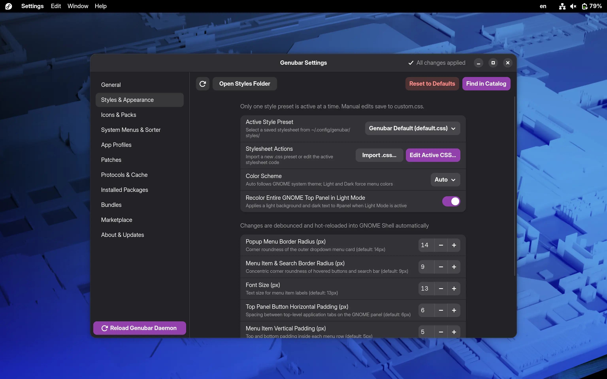
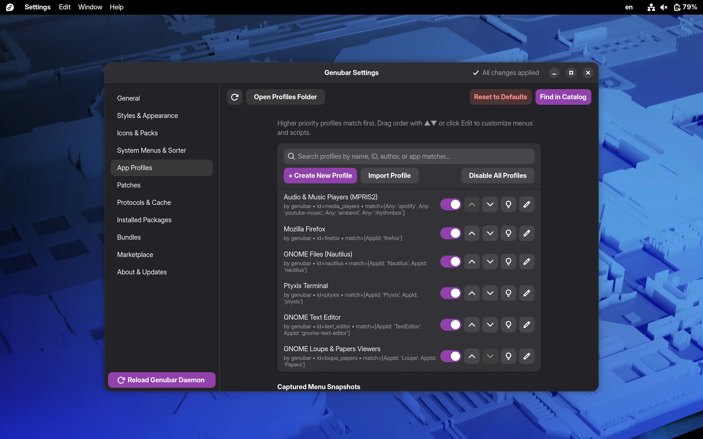
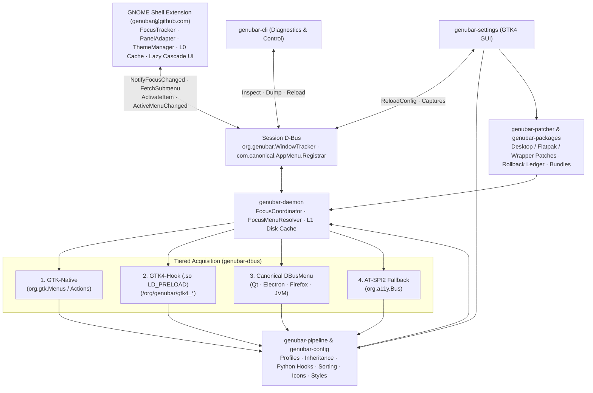

#  Genubar

Universal global menubar ecosystem for **GNOME Shell (47–51)** on Linux (Wayland & X11). Genubar unifies application menus into the GNOME top panel across **GTK4 / Libadwaita**, **GTK3**, **Qt / KDE**, **Electron / Chromium**, **Firefox / Thunderbird**, **JetBrains / JVM**, and **Flatpak** applications — backed by a declarative customization engine, reversible application patch manager, and GTK4/Libadwaita settings app.

- **GNOME Shell Extension:** [genubar/genubar-gnome-extension](https://github.com/genubar/genubar-gnome-extension) (`genubar@github.com`)
- **Update & Package Registry:** [genubar/genubar-registry](https://github.com/genubar/genubar-registry)

## Screenshots

| Dark Mode (Nautilus GTK4 Hook Cascade) | Light Mode (Full Top Panel + Popups) |
| --- | --- |
|  |  |


<details>
<summary>Genubar Settings App (Styles, Profiles, Patches, Bundles)</summary>

| Styles & Appearance | App Profiles |
| --- | --- |
|  |  |

| Application Patches | Composite Bundles |
| --- | --- |
|  |  |

</details>

---

## Supported Applications & Backends

| App Ecosystem | How Genubar Integrates | Reversible Patch Included |
| --- | --- | --- |
| **GTK4 & Libadwaita** (Nautilus, Ptyxis, Text Editor, Loupe, Papers, GNOME Core) | `LD_PRELOAD` `libgenubar_gtk4_hook.so` extracts in-window popovers + live states | Yes (`gnome_core_apps_gtk4_hook`) |
| **GTK3** (traditional `GtkMenuBar` / `GApplication` apps) | Native `org.gtk.Menus` / `org.gtk.Actions` D-Bus export | Automatic / optional hook |
| **Electron / VS Code / Chromium** | Native `com.canonical.dbusmenu` + `XDG_CURRENT_DESKTOP` scoping | Yes (`vscode_x11_dbusmenu`, etc.) |
| **Firefox / Thunderbird** | `com.canonical.dbusmenu` (`MOZ_DBUSMENU_ENABLE`) or AT-SPI2 | Yes (`firefox.toml` profile + patches) |
| **JetBrains IDEs** (RustRover, IntelliJ, etc.) & **Qt / KDE** | `com.canonical.dbusmenu` with lazy Swing/Qt submenu loading | Yes (`jetbrains_*` patches) |
| **Flatpak Apps** | Flatpak overrides with read-only `~/.local/lib/genubar:ro` hook access | Yes (`flatpak_override` steps) |
| **Other / Fallback Apps** | AT-SPI2 Accessibility Bus + universal Edit / Window / Help / SearchBar | Works out of the box |

---

## Quick FAQ

- **Does it work on both Wayland and X11?** Yes. The GNOME Shell extension, focus tracker, D-Bus daemon, GTK4 hook, and shortcut synthesizer work on both GNOME Wayland and GNOME X11 (`47`–`51`). On Wayland, log out and back in once after installing the extension so GNOME Shell discovers it.
- **Are application patches safe to apply?** Yes. Every patch records original files/values and patch ownership in `~/.config/genubar/patch_ledger.json`. Clicking **Revert** (or running `genubar-cli revert-patch --id <id>`) restores the exact prior state.
- **How do I completely remove Genubar?** Run `genubar-installer --uninstall` (removes binaries, hook, extension, and systemd unit while preserving `~/.config/genubar`), or `genubar-installer --uninstall --purge` to remove all configs and caches as well.

---

## Architecture Overview

Genubar separates GNOME Shell rendering, background D-Bus orchestration, per-app menu acquisition, and in-process GTK4 extraction:



---

## Workspace Crates

| Crate | Role | Documentation |
| --- | --- | --- |
| genubar-protocol | Zero-dependency IPC constants, D-Bus names, action contracts, extension file list | [crates/genubar-protocol/README.md](crates/genubar-protocol/README.md) |
| genubar-core | Domain models (`MenuNode`, `MenuItemType`, `CustomAction`), SemVer compat, `MenuProvider` | [crates/genubar-core/README.md](crates/genubar-core/README.md) |
| genubar-platform | XDG paths, atomic FS ops, `/proc` probing, CSS sync, embedded extension installer | [crates/genubar-platform/README.md](crates/genubar-platform/README.md) |
| genubar-config | Persistent TOML/CSS config models, factory defaults, bootstrapper & repos | [crates/genubar-config/README.md](crates/genubar-config/README.md) |
| genubar-pipeline | Multi-stage menu pipeline: rules, inheritance, Python hooks, sorting, icons | [crates/genubar-pipeline/README.md](crates/genubar-pipeline/README.md) |
| genubar-patcher | Condition evaluator, `.desktop`/CLI/Flatpak/GSettings/JSON appliers, rollback ledger | [crates/genubar-patcher/README.md](crates/genubar-patcher/README.md) |
| genubar-packages | Bundle orchestration, remote `app.json` & `registry.json` package manager | [crates/genubar-packages/README.md](crates/genubar-packages/README.md) |
| genubar-dbus | Async clients for Canonical DBusMenu, GTK/Gtk4Bridge, AT-SPI2 & daemon D-Bus server | [crates/genubar-dbus/README.md](crates/genubar-dbus/README.md) |
| genubar-daemon | Background D-Bus service coordinating focus, acquisition tiers, L1 cache & dispatch | [crates/genubar-daemon/README.md](crates/genubar-daemon/README.md) |
| genubar-gtk4-hook | `LD_PRELOAD` shared library (`libgenubar_gtk4_hook.so`) extracting GTK4/3 menus | [crates/genubar-gtk4-hook/README.md](crates/genubar-gtk4-hook/README.md) |
| genubar-cli | CLI diagnostic & management tool (`genubar-cli`) | [crates/genubar-cli/README.md](crates/genubar-cli/README.md) |
| genubar-ui | GTK4 + Libadwaita configuration manager (`genubar-settings`) | [crates/genubar-ui/README.md](crates/genubar-ui/README.md) |
| genubar-installer | Self-contained GUI/CLI installer deploying binaries, hook, extension & systemd unit | [crates/genubar-installer/README.md](crates/genubar-installer/README.md) |

Additional repository assets:
- [systemd/genubar.service](systemd/genubar.service) — Reference systemd user unit for manual installation.
- **Included submodule & companion repository:** [genubar-gnome-extension](https://github.com/genubar/genubar-gnome-extension) (nested under `genubar-gnome-extension/` and embedded into `genubar-installer` at compile time) and [genubar-registry](https://github.com/genubar/genubar-registry) (`app.json` release manifest & package catalog).

---

## Requirements

- **Runtime only (for prebuilt Releases — Method 1):** GNOME Shell `47`–`51`, `systemd --user`, D-Bus session bus, `gtk4` + `libadwaita` runtime libraries (pre-installed on GNOME desktops), optional `python3` (for `# ==GenubarScript==` transformers), `curl` & `tar` (used if downloading release archives from `genubar-installer`). **No Rust compiler or `-devel` / `-dev` build headers are required.**
- **Building from source (Method 2 & Method 3):** Rust toolchain (edition `2024`, Cargo), `pkg-config`, and GTK4 / Libadwaita development headers (`gtk4-devel` + `libadwaita-devel` on Fedora, or `libgtk-4-dev` + `libadwaita-1-dev` on Debian/Ubuntu), with the [genubar-gnome-extension](https://github.com/genubar/genubar-gnome-extension) submodule checked out at `./genubar-gnome-extension/` (`genubar-platform` embeds those extension files at compile time).

---

## Installation

### Method 1: Prebuilt Installer from GitHub Releases (Fastest)

1. Download the latest release binary / archive (for example `genubar-installer` or `genubar-v0.1.0-linux-x86_64.tar.gz`) from the [GitHub Releases](https://github.com/genubar/genubar/releases) page.
2. Extract (if using a `.tar.gz` archive) and run the installer — no Rust toolchain or `-devel` headers needed:

```bash
# If using a release archive:
tar -xzf genubar-v0.1.0-linux-x86_64.tar.gz

# Option A: Open the graphical GTK4 installer window (or double-click genubar-installer)
chmod +x ./genubar-installer
./genubar-installer

# Option B: Headless CLI install
./genubar-installer --install
```

`genubar-installer` deploys binaries to `~/.local/bin/`, `libgenubar_gtk4_hook.so` to `~/.local/lib/genubar/`, the embedded GNOME Shell extension to `~/.local/share/gnome-shell/extensions/genubar@github.com/`, and enables `~/.config/systemd/user/genubar.service` for automatic background startup on login.

### Method 2: Build from Source with Automated Installer

Clone `genubar` with `--recurse-submodules` so `./genubar-gnome-extension/` is populated for `genubar-platform` compile-time embedding:

```bash
git clone --recurse-submodules https://github.com/genubar/genubar.git
cd genubar

# If you already cloned without --recurse-submodules, run:
# git submodule update --init --recursive

# Build all workspace artifacts in release mode
cargo build --workspace --release

# Launch the GUI installer or run headless install
./target/release/genubar-installer
# or:
./target/release/genubar-installer --install
```

Other installer CLI flags:
- `--update` — updates binaries, hook, extension, and refreshes `genubar.service`
- `--install-extension` — installs or updates only `~/.local/share/gnome-shell/extensions/genubar@github.com`
- `--uninstall` — reverts applied system/app patches from `patch_ledger.json` and removes extension, systemd service, binaries, and `~/.local/lib/genubar` (preserves `~/.config/genubar`)
- `--uninstall --purge` — reverts applied patches and performs full removal including `~/.config/genubar`, `~/.cache/genubar`, and `~/.local/share/genubar`

### Method 3: Manual Build and File Placement

Clone the repository with its extension submodule as in Method 2, then run **all** commands below from inside the root of `genubar/`:

```bash
# Run from inside genubar/ (with ./genubar-gnome-extension/ checked out)
# 1. Build everything in release mode
cargo build --workspace --release

# 2. Install executables
mkdir -p ~/.local/bin
install -m 755 target/release/genubar-daemon ~/.local/bin/
install -m 755 target/release/genubar-cli ~/.local/bin/
install -m 755 target/release/genubar-settings ~/.local/bin/
install -m 755 target/release/genubar-installer ~/.local/bin/

# 3. Install the GTK4/GTK3 LD_PRELOAD hook
mkdir -p ~/.local/lib/genubar
install -m 755 target/release/libgenubar_gtk4_hook.so ~/.local/lib/genubar/libgenubar_gtk4_hook.so
cp ~/.local/lib/genubar/libgenubar_gtk4_hook.so ~/.local/lib/genubar/active_gtk4_hook.so

# 4. Install and enable the GNOME Shell extension
EXT_DIR="$HOME/.local/share/gnome-shell/extensions/genubar@github.com"
mkdir -p "$EXT_DIR"
cp -r genubar-gnome-extension/{metadata.json,extension.js,stylesheet.css,lib} "$EXT_DIR"/
gnome-extensions enable genubar@github.com

# 5. Install and start the systemd user service
mkdir -p ~/.config/systemd/user
cp systemd/genubar.service ~/.config/systemd/user/genubar.service
systemctl --user daemon-reload
systemctl --user enable --now genubar.service
```

If `~/.local/bin` is not where you placed `genubar-daemon`, edit `ExecStart=` in `~/.config/systemd/user/genubar.service` accordingly before running `daemon-reload`.

On **Wayland**, log out and log back in once after first install so GNOME Shell discovers `~/.local/share/gnome-shell/extensions/genubar@github.com`. On **X11**, press `Alt+F2`, type `r`, and press `Enter`.

### Method 4: Development and Debugging Setup

When hacking on `genubar-daemon`, `genubar-gtk4-hook`, or the GNOME Shell extension, stop the background service so your terminal session owns the D-Bus names (`org.genubar.WindowTracker` and `com.canonical.AppMenu.Registrar`):

```bash
# Stop the background systemd service (use `disable --now` to keep it off across logins)
systemctl --user stop genubar.service

# Run the daemon in the foreground with verbose logs
RUST_LOG=debug cargo run -p genubar-daemon

# Restore the background systemd service when done
systemctl --user start genubar.service
```

Useful live debugging commands:

```bash
# Reload ~/.config/genubar configs on a running daemon without restarting
genubar-cli reload-config

# Test the GTK4 hook on a single application with verbose stderr/file logs
GENUBAR_GTK4_DEBUG=1 GENUBAR_GTK4_HIDE_BUTTONS=1 \
  LD_PRELOAD=$PWD/target/debug/libgenubar_gtk4_hook.so nautilus --new-window

# Inspect live protocol trees
genubar-cli discover --dest :1.234
genubar-cli inspect-atspi --pid "$(pidof firefox | awk '{print $1}')"
genubar-cli dump-gtk4 --pid "$(pidof nautilus | awk '{print $1}')"

# Watch GNOME Shell extension logs
journalctl -f /usr/bin/gnome-shell
```

---

## Customization and Configuration

On first startup, `genubar-daemon` or `genubar-settings` populates `~/.config/genubar/` with self-documented default configuration templates. Every TOML/CSS file explains its options, widget selectors, and examples inline — edit either through **Genubar Settings** (`genubar-settings`) or directly in `~/.config/genubar/` (followed by `genubar-cli reload-config`):

```text
~/.config/genubar/
├── settings.toml            # Global behavior, style metrics, theme mode, API tier flags
├── style.css                # Active compiled stylesheet + St/Clutter widget anatomy guide
├── styles/                  # CSS presets with /* ==GenubarStyle== */ metadata headers
├── desktop_menu.toml        # Desktop Idle mode menu columns ({os_name}, places, tools)
├── app_menu.toml            # Universal template merged into focused app menus (Edit, Help, SearchBar)
├── icons.toml               # Icon column / check / radio policies & system fallback rules
├── icons/<pack>/pack.toml   # Priority custom icon packs (.svg / .png rules)
├── profiles/*.toml          # Per-application matchers and column inheritance overrides
├── patches/*.toml          # Custom application patches (plus built-in patch catalog)
├── bundles/<id>/bundle.toml # Grouped patch + profile + style + icon packs
├── scripts/*.py             # Python menu_transformer / patch_script plugins (# ==GenubarScript==)
├── snapshots/*.json         # Captured app menu snapshots for profile generation
└── patch_ledger.json        # Transactional backup state for reverting applied patches
```

### Genubar Settings UI

Run `genubar-settings` to configure all 11 areas visually with live daemon reload:
- **General:** Overflow (`More`) column limit, Python binary path/timeout, patch error policy, config resets.
- **Styles & Theme:** `Auto` / `Dark` / `Light` theme mode, top-panel recoloring, stylesheet sync mode (`copy_to_extension`, `symlink_to_extension`, `direct_extension_file`), and live pixel metrics (`max_column_height_px`, `min_column_width_px`, `panel_button_hpadding_px`, `item_vpadding_px`, `item_hpadding_px`, `popup_border_radius_px`, `item_border_radius_px`, `font_size_px`). See the ASCII selector diagram at the top of [crates/genubar-config/defaults/style.css](crates/genubar-config/defaults/style.css) when building custom CSS themes.
- **Icons:** Toggle menu icons, reserve columns (`always` / `auto` / `never`), choose check/radio style (`symbol` / `icon` / `box`) and placement, and toggle custom packs.
- **System Menus:** Customize top-level column sorting order (`Standard`, `Custom`, or Python script) and edit `desktop_menu.toml` / `app_menu.toml`.
- **Profiles:** Match apps by `app_id`, `title`, or `any`; reorder or merge columns (`inherit`, `inherit_others`, `merge_with_live`, `sync_new_items`); capture live app snapshots and turn them into profiles with one click.
- **Patches & Bundles:** Detect installed apps on the system, apply/revert patches safely (with automatic `.desktop`, Flatpak, GSettings, JSON, or wrapper rollback), or enable/disable entire application bundles.
- **Protocols & Cache:** Enable/disable `gtk_native`, `gtk4_hook`, `canonical_dbus`, and `atspi` acquisition tiers, configure AT-SPI traversal depth, and inspect/clear the L1 disk cache.
- **Installed, Marketplace & About:** Manage installed items, browse registry feeds, and verify two-way compatibility between `genubar-daemon` and `genubar@github.com`.

### Supported Menu Actions in Profiles and Templates

Custom menu items in `desktop_menu.toml`, `app_menu.toml`, and `profiles/*.toml` support:
- `gtk:<action>` — triggers GTK app/win/slot actions (supports fallback chains like `gtk:slot.focus-search|slot.search-visible`)
- `sys:<slug>` — triggers built-in daemon/extension actions (`quit_app`, `close_window`, `minimize_window`, `maximize_window`, `fullscreen_window`, `always_on_top`, `move_workspace_left`, `move_workspace_right`, `center_window`, `transform_upper`, `transform_lower`, `transform_capitalize`, `refresh_menu`, `reload_config`, `capture_menu_snapshot`, `lock_screen`, `logout`)
- `key:<shortcut>` — synthesizes a keyboard shortcut against the active window (`key:Ctrl+Z`, `key:Ctrl+Shift+V`)
- `cmd:<command>` / `sh:<shell>` — launches a command or shell pipeline cleanly detached
- `uri:<target>` — opens a URL or local path (`uri:~/Downloads`)
- `dbus:<dest>|<path>|<iface>|<method>` — invokes a D-Bus method directly

### Python Menu Transformers

Drop executable scripts marked with a `# ==GenubarScript== ... # ==/GenubarScript==` header into `~/.config/genubar/scripts/` and reference them from `profiles/*.toml`, `app_menu.toml`, `desktop_menu.toml`, or `root_sorting.python_script`. Genubar writes `{ "window": ..., "tier": ..., "root": ... }` to STDIN and reads the transformed `MenuNode` JSON from STDOUT. See [example_menu_transformer.py](crates/genubar-config/defaults/scripts/example_menu_transformer.py) for a complete template.

---

## Testing

```bash
cargo test --workspace
```

## License

Licensed under the [MIT License](LICENSE).
