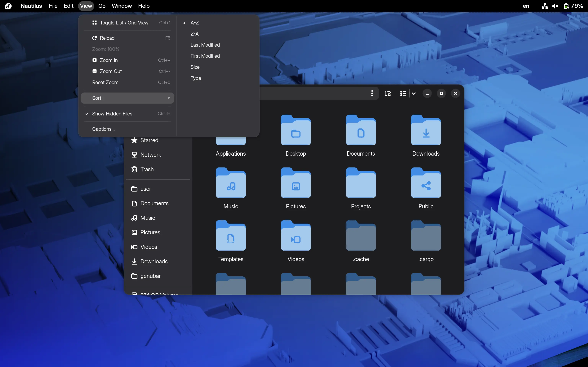
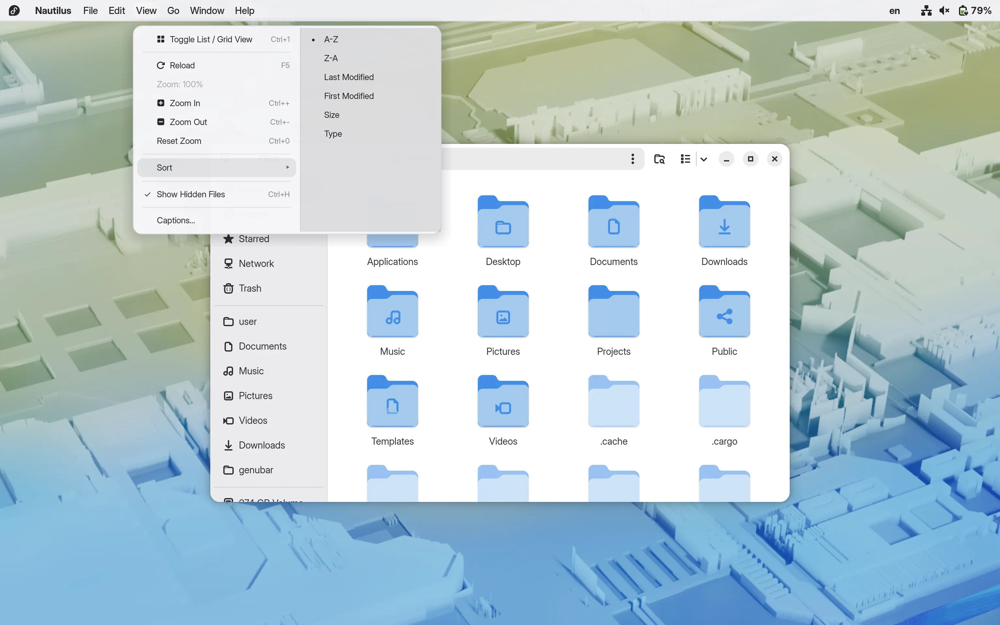
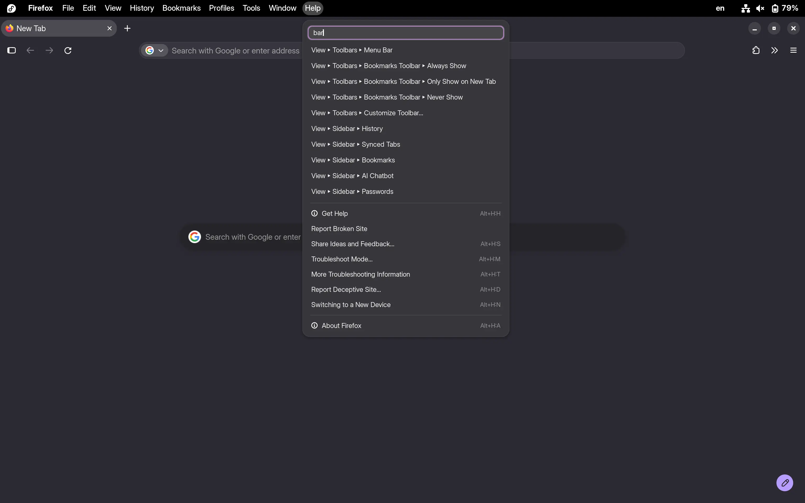
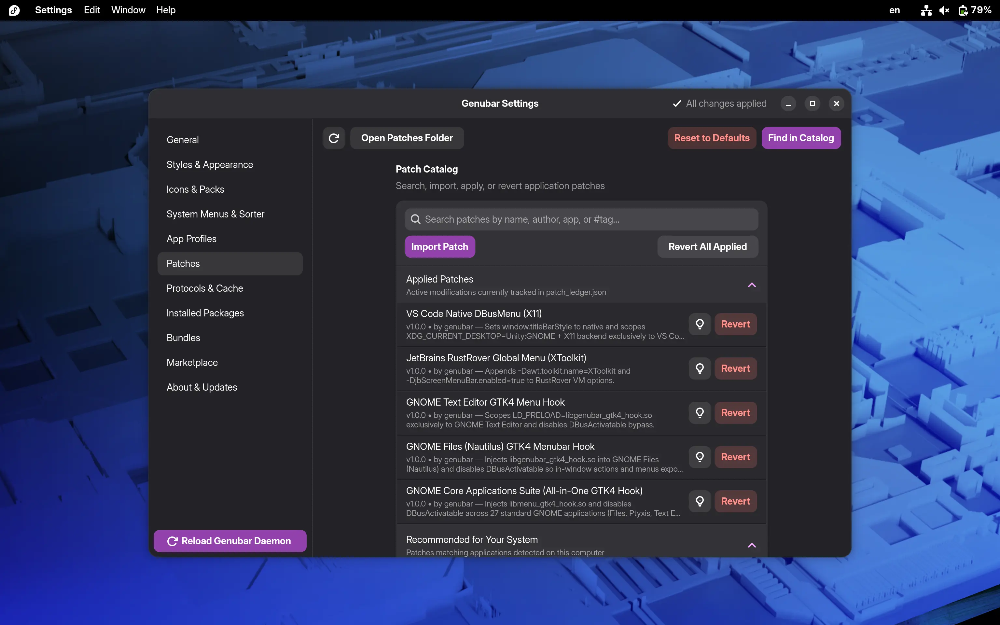
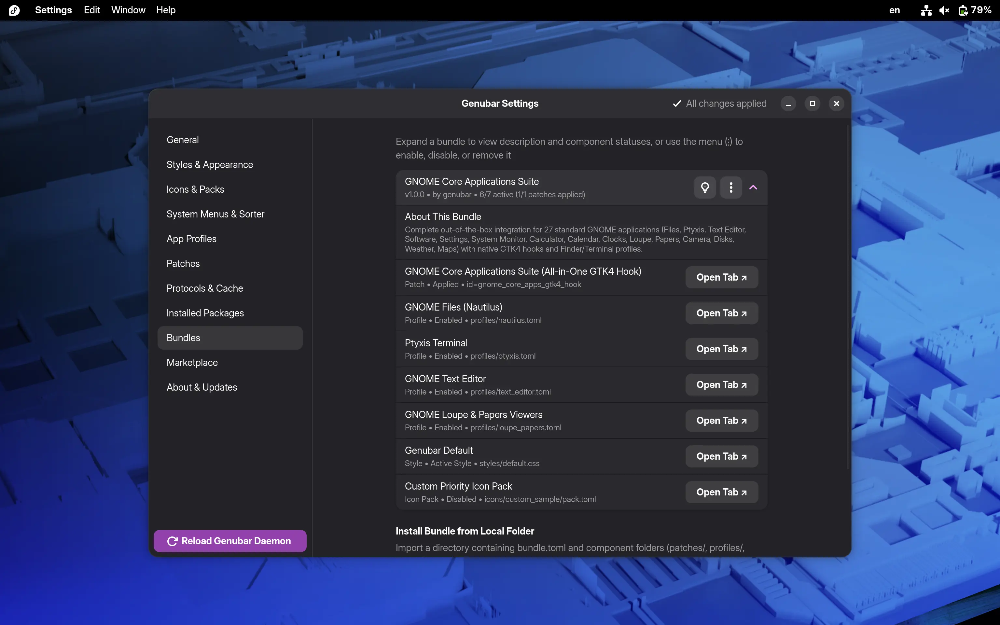
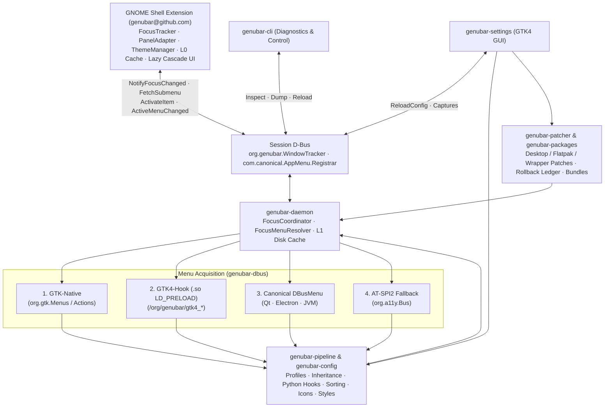

#  Genubar

Global menubar for **GNOME on Wayland** (GNOME Shell 47+, with `shell-version` 47–51 in `metadata.json`; supporting native Wayland and XWayland applications). Genubar places application menus in the GNOME top panel across **GTK4 / Libadwaita**, **GTK3**, **Qt / KDE**, **Electron / Chromium**, **Firefox**, and **JetBrains** applications, backed by declarative TOML profiles, a reversible application patch manager, and a GTK4/Libadwaita settings app.

- **GNOME Shell Extension:** [genubar/genubar-gnome-extension](https://github.com/genubar/genubar-gnome-extension) (`genubar@github.com`)
- **Update & Package Registry:** [genubar/genubar-registry](https://github.com/genubar/genubar-registry)

## Screenshots

| Dark Mode (Nautilus) | Light Mode (Nautilus) |
| --- | --- |
|  |  |



<details>
<summary>Genubar Settings App (Styles, Profiles, Patches, Bundles)</summary>

| Styles & Appearance | App Profiles |
| --- | --- |
|  |  |

| Application Patches | Composite Bundles |
| --- | --- |
|  |  |

</details>

---

## Key Features & Supported Backends

- **Multi-Protocol Menu Extraction:** Reads native GTK3 `org.gtk.Menus`, injected GTK4/GTK3 popover trees (`libgenubar_gtk4_hook.so`), `com.canonical.dbusmenu` (Qt, Electron, JetBrains), and AT-SPI2 (`org.a11y.Bus`).
- **Declarative Customization:** Per-application TOML profiles with live menu inheritance, Python menu transformer scripts, custom icon packs, and GNOME Shell CSS theme/metric syncing.
- **Reversible Application Patcher:** Tracks all `.desktop`, D-Bus `.service`, CLI wrapper, JSON, GSettings, and Flatpak overrides in `~/.config/genubar/patch_ledger.json` for clean rollback.
- **Graphical Settings Manager:** `genubar-settings` provides live configuration, snapshot capture, profile generation, and extension/daemon update checks.

### Supported Applications & Backends

| App Ecosystem | How Genubar Integrates | Reversible Patch Included |
| --- | --- | --- |
| **GTK4 & Libadwaita** (Nautilus, Ptyxis, Text Editor, Loupe, Papers, GNOME apps) | `LD_PRELOAD` `libgenubar_gtk4_hook.so` extracts `GtkPopoverMenu` models & widget-scoped action states | Yes (`gnome_core_apps_gtk4_hook`) |
| **GTK3** (`GtkMenuBar` / `GApplication` apps, Inkscape) | Native `org.gtk.Menus` / `org.gtk.Actions` D-Bus export (or optional hook) | Automatic / `inkscape_menubar_hook` |
| **Electron / VS Code / Chromium** | `com.canonical.dbusmenu` via XWayland + `XDG_CURRENT_DESKTOP` scoping (or AT-SPI2) | Yes (`vscode_x11_dbusmenu`) |
| **Firefox** | AT-SPI2 Accessibility Bus (`org.a11y.Bus`) with disk submenu caching | Profile included (`firefox.toml`) |
| **JetBrains IDEs (RustRover) & Qt / KDE** | `com.canonical.dbusmenu` with lazy Swing/Qt submenu loading | Yes (`jetbrains_rustrover_xtoolkit`; Qt works natively) |
| **Flatpak Apps (Experimental)** | User Flatpak overrides with read-only `~/.local/lib/genubar:ro` hook access | Included for select GTK4 Flatpaks (`flatpak_override`) |
| **Other / Fallback Apps** | AT-SPI2 Accessibility Bus + universal `Edit` / `Window` / `Help` / `SearchBar` | Works out of the box |

---

## Requirements

### Runtime (Prebuilt Releases)

- **Session:** GNOME Shell 47+ on **Wayland** (`shell-version` 47–51 in `metadata.json`; native Wayland and XWayland applications supported)
- **System Services & Libraries:** `systemd --user`, D-Bus session bus, `gtk4` + `libadwaita` runtime libraries (pre-installed on GNOME desktops)
- **Optional:** `python3` (for `# ==GenubarScript==` transformers), `curl` & `tar` (used if downloading release archives from `genubar-installer`)
- *No Rust compiler or `-devel` / `-dev` headers are required.*

### Building from Source

- **Toolchain:** Rust toolchain (Edition `2024`, Cargo), `pkg-config`
- **Development Headers:** GTK4 and Libadwaita headers (`gtk4-devel` + `libadwaita-devel` on Fedora, or `libgtk-4-dev` + `libadwaita-1-dev` on Debian/Ubuntu)
- **Submodule:** [genubar-gnome-extension](https://github.com/genubar/genubar-gnome-extension) checked out at `./genubar-gnome-extension/` (`genubar-platform` embeds those extension files at compile time)

---

## Installation

### Method 1: Prebuilt Release Archive (Fastest)

1. Download the latest release archive (for example `genubar-v0.1.0-linux-x86_64.tar.gz`) from the [GitHub Releases](https://github.com/genubar/genubar/releases) page.
2. Extract the archive and run `genubar-installer` from the extracted folder — no Rust toolchain or `-devel` headers needed:

```bash
tar -xzf genubar-v0.1.0-linux-x86_64.tar.gz
cd genubar-v0.1.0-linux-x86_64

# Option A: Open the graphical GTK4 installer window (or double-click genubar-installer)
chmod +x ./genubar-installer
./genubar-installer

# Option B: Headless CLI install
./genubar-installer --install
```

`genubar-installer` deploys binaries to `~/.local/bin/`, `libgenubar_gtk4_hook.so` to `~/.local/lib/genubar/`, the embedded GNOME Shell extension to `~/.local/share/gnome-shell/extensions/genubar@github.com/`, and enables `~/.config/systemd/user/genubar.service`. Log out and log back in once after first install so GNOME Shell discovers the extension.

### Method 2: Build from Source with Automated Installer

Clone `genubar` with `--recurse-submodules` so `./genubar-gnome-extension/` is populated for `genubar-platform` compile-time embedding:

```bash
git clone --recurse-submodules https://github.com/genubar/genubar.git
cd genubar

# If you already cloned without --recurse-submodules, run:
# git submodule update --init --recursive

# Build all workspace artifacts in release mode
cargo build --workspace --release

# Launch the GUI installer or run headless install
./target/release/genubar-installer
# or:
./target/release/genubar-installer --install
```

Other installer CLI flags:
- `--update` — updates binaries, hook, extension, and refreshes `genubar.service`
- `--install-extension` — installs or updates only `~/.local/share/gnome-shell/extensions/genubar@github.com`
- `--uninstall` — reverts applied system/app patches from `patch_ledger.json` and removes extension, systemd service, binaries, and `~/.local/lib/genubar` (preserves `~/.config/genubar`)
- `--uninstall --purge` — reverts applied patches and performs full removal including `~/.config/genubar`, `~/.cache/genubar`, and `~/.local/share/genubar`

### Method 3: Manual Build and File Placement

Clone the repository with its extension submodule as in Method 2, then run **all** commands below from inside the root of `genubar/`:

```bash
# Run from inside genubar/ (with ./genubar-gnome-extension/ checked out)
# 1. Build everything in release mode
cargo build --workspace --release

# 2. Install executables
mkdir -p ~/.local/bin
install -m 755 target/release/genubar-daemon ~/.local/bin/
install -m 755 target/release/genubar-cli ~/.local/bin/
install -m 755 target/release/genubar-settings ~/.local/bin/
install -m 755 target/release/genubar-installer ~/.local/bin/

# 3. Install the GTK4/GTK3 LD_PRELOAD hook
mkdir -p ~/.local/lib/genubar
install -m 755 target/release/libgenubar_gtk4_hook.so ~/.local/lib/genubar/libgenubar_gtk4_hook.so
cp ~/.local/lib/genubar/libgenubar_gtk4_hook.so ~/.local/lib/genubar/active_gtk4_hook.so

# 4. Install and enable the GNOME Shell extension
EXT_DIR="$HOME/.local/share/gnome-shell/extensions/genubar@github.com"
mkdir -p "$EXT_DIR"
cp -r genubar-gnome-extension/{metadata.json,extension.js,stylesheet.css,lib} "$EXT_DIR"/
gnome-extensions enable genubar@github.com

# 5. Install and start the systemd user service
mkdir -p ~/.config/systemd/user
cp systemd/genubar.service ~/.config/systemd/user/genubar.service
systemctl --user daemon-reload
systemctl --user enable --now genubar.service
```

If `~/.local/bin` is not where you placed `genubar-daemon`, edit `ExecStart=` in `~/.config/systemd/user/genubar.service` accordingly before running `daemon-reload`.

Log out and log back in once after first install so GNOME Shell on Wayland loads `~/.local/share/gnome-shell/extensions/genubar@github.com/`.

### Method 4: Development and Debugging Setup

When hacking on `genubar-daemon`, `genubar-gtk4-hook`, or the GNOME Shell extension, stop the background service so your terminal session owns the D-Bus names (`org.genubar.WindowTracker` and `com.canonical.AppMenu.Registrar`):

```bash
# Stop the background systemd service (use `disable --now` to keep it off across logins)
systemctl --user stop genubar.service

# Run the daemon in the foreground with verbose logs
RUST_LOG=debug cargo run -p genubar-daemon

# Restore the background systemd service when done
systemctl --user start genubar.service
```

Useful live debugging commands:

```bash
# Reload ~/.config/genubar configs on a running daemon without restarting
genubar-cli reload-config

# Test the GTK4 hook on a single application with verbose stderr/file logs
GENUBAR_GTK4_DEBUG=1 GENUBAR_GTK4_HIDE_BUTTONS=1 \
  LD_PRELOAD=$PWD/target/debug/libgenubar_gtk4_hook.so nautilus --new-window

# Inspect live protocol trees
genubar-cli discover --dest :1.234
genubar-cli inspect-atspi --pid "$(pidof firefox | awk '{print $1}')"
genubar-cli dump-gtk4 --pid "$(pidof nautilus | awk '{print $1}')"

# Watch GNOME Shell extension logs
journalctl -f /usr/bin/gnome-shell
```

---

## Customization and Configuration

On first startup, `genubar-daemon` or `genubar-settings` populates `~/.config/genubar/` with default configuration templates. Every TOML/CSS file documents its options, widget selectors, and examples inline — edit either through **Genubar Settings** (`genubar-settings`) or directly in `~/.config/genubar/` (followed by `genubar-cli reload-config`):

```text
~/.config/genubar/
├── settings.toml            # Global behavior, style metrics, theme mode, protocol flags
├── style.css                # Active compiled stylesheet + St/Clutter widget anatomy guide
├── styles/                  # CSS presets with /* ==GenubarStyle== */ metadata headers
├── desktop_menu.toml        # Desktop Idle mode menu columns ({os_name}, places, tools)
├── app_menu.toml            # Universal template merged into focused app menus (Edit, Help, SearchBar)
├── icons.toml               # Icon column / check / radio policies & system fallback rules
├── icons/<pack>/pack.toml   # Priority custom icon packs (.svg / .png rules)
├── profiles/*.toml          # Per-application matchers and column inheritance overrides
├── patches/*.toml          # Custom application patches (plus built-in patch catalog)
├── bundles/<id>/bundle.toml # Grouped patch + profile + style + icon packs
├── scripts/*.py             # Python menu_transformer / patch_script plugins (# ==GenubarScript==)
├── snapshots/*.json         # Captured app menu snapshots for profile generation
└── patch_ledger.json        # Transactional backup state for reverting applied patches
```

### Genubar Settings UI

Run `genubar-settings` to configure all 11 areas visually with live daemon reload:
- **General:** Overflow (`More`) column limit, Python binary path/timeout, and configuration resets.
- **Styles & Appearance:** `Auto` / `Dark` / `Light` theme mode, top-panel recoloring, stylesheet sync mode (`copy_to_extension`, `symlink_to_extension`, `direct_extension_file`), and live pixel metrics (`max_column_height_px`, `min_column_width_px`, `panel_button_hpadding_px`, `item_vpadding_px`, `item_hpadding_px`, `popup_border_radius_px`, `item_border_radius_px`, `font_size_px`). See the selector diagram at the top of [crates/genubar-config/defaults/style.css](crates/genubar-config/defaults/style.css) when building custom CSS themes.
- **Icons & Packs:** Toggle menu icons, reserve columns (`always` / `auto` / `never`), choose check/radio style (`symbol` / `icon` / `box`) and placement, and toggle custom packs.
- **System Menus & Sorter:** Customize top-level column sorting order (`Standard`, `Custom`, or Python script) and edit `desktop_menu.toml` / `app_menu.toml`.
- **App Profiles:** Match apps by `app_id`, `title`, or `any`; reorder or merge columns (`inherit`, `inherit_others`, `merge_with_live`, `sync_new_items`); capture live app snapshots and turn them into profiles.
- **Patches & Bundles:** Detect installed apps, apply/revert patches safely (with `.desktop`, D-Bus `.service`, Flatpak, GSettings, JSON, or wrapper rollback), or toggle bundles.
- **Protocols & Cache:** Enable/disable GTK Native, GTK4 Hook, Canonical DBusMenu, and AT-SPI2 backends, configure AT-SPI traversal depth, and inspect/clear disk caches.
- **Installed Packages, Marketplace & About:** Manage installed items, browse registry feeds, and verify two-way compatibility between `genubar-daemon` and `genubar@github.com`.

### Supported Menu Actions in Profiles and Templates

Custom menu items in `desktop_menu.toml`, `app_menu.toml`, and `profiles/*.toml` support:
- `gtk:<action>` — triggers GTK app/win/slot actions (supports fallback chains like `gtk:slot.focus-search|slot.search-visible`)
- `sys:<slug>` — triggers built-in daemon/extension actions (`quit_app`, `close_window`, `minimize_window`, `maximize_window`, `fullscreen_window`, `always_on_top`, `move_workspace_left`, `move_workspace_right`, `center_window`, `transform_upper`, `transform_lower`, `transform_capitalize`, `refresh_menu`, `reload_config`, `capture_menu_snapshot`, `lock_screen`, `logout`)
- `key:<shortcut>` — synthesizes a keyboard shortcut against the active window (`key:Ctrl+Z`, `key:Ctrl+Shift+V`)
- `copy:<text>` / `insert:<text>` — copies text to the clipboard or inserts text into the active application
- `cmd:<command>` / `sh:<shell>` — launches a command or shell pipeline detached
- `uri:<target>` — opens a URL or local path (`uri:~/Downloads`)
- `dbus:<dest>|<path>|<iface>|<method>` — invokes a session D-Bus method directly

### Python Menu Transformers

Drop executable scripts marked with a `# ==GenubarScript== ... # ==/GenubarScript==` header into `~/.config/genubar/scripts/` and reference them from `profiles/*.toml`, `app_menu.toml`, `desktop_menu.toml`, or `root_sorting.python_script`. Genubar writes `{ "window": ..., "tier": ..., "root": ... }` to STDIN and reads the transformed `MenuNode` JSON from STDOUT. See [example_menu_transformer.py](crates/genubar-config/defaults/scripts/example_menu_transformer.py) for a template.

---

## System Modifications & Uninstallation

Genubar operates strictly within your user home directory (no `sudo` or system `/usr` files are modified):

- **How `libgenubar_gtk4_hook.so` (`LD_PRELOAD`) works:** The hook is never exported globally across your session. It is injected per-application only for patches you explicitly apply, resolves GTK/GLib symbols dynamically via the dynamic linker (`ld.so` / `dlsym`), runs within the application's GLib main loop (`GMainLoop`), and clears `LD_PRELOAD` inside `g_application_run` so child processes (shells, compilers, browsers) spawned by the app start unhooked.
- **User files created during installation and patching:**
  - `~/.local/bin/` — `genubar-daemon`, `genubar-cli`, `genubar-settings`, and optional wrapper scripts from `cli_wrapper` patches
  - `~/.local/lib/genubar/` — `libgenubar_gtk4_hook.so` and `active_gtk4_hook.so`
  - `~/.local/share/gnome-shell/extensions/genubar@github.com/` — GNOME Shell extension files
  - `~/.config/systemd/user/genubar.service` — user systemd service unit
  - `~/.local/share/applications/` — `org.genubar.Settings.desktop` and user `.desktop` overrides for patched apps
  - `~/.local/share/dbus-1/services/` — user D-Bus `.service` overrides for patched `DBusActivatable` GTK4 apps (so D-Bus-activated launches receive `LD_PRELOAD`)
  - `~/.local/share/icons/hicolor/scalable/apps/` — `org.genubar.Settings.svg` and `org.genubar.Installer.svg`
  - `~/.local/share/flatpak/overrides/` — user Flatpak overrides (only when applying `flatpak_override` patch steps)
  - `~/.config/genubar/` & `~/.cache/genubar/` — user configuration files, transactional rollback state (`patch_ledger.json`), and disk menu caches (`l1_roots.json`, `atspi_menus.json`)
- **Reverting patches & full removal:**
  - Revert any patch or bundle in **Genubar Settings** (**Patches** / **Bundles**) or via `genubar-cli revert-patch --id <id>` / `genubar-cli revert-bundle --id <id>`. Original files and settings are restored from `patch_ledger.json`.
  - Run `genubar-installer --uninstall` to revert all active patches from `patch_ledger.json` and remove binaries, hook library, extension, desktop/icon assets, and `genubar.service` (keeping `~/.config/genubar`).
  - Run `genubar-installer --uninstall --purge` to also delete `~/.config/genubar`, `~/.cache/genubar`, and `~/.local/share/genubar`.

---

## Known Limitations

- **Extension reload on GNOME Wayland:** GNOME Shell on Wayland cannot hot-reload extensions in-place. Log out and back in once after installing or updating the extension.
- **AT-SPI2 initial submenu scan (Firefox):** When first focusing an application that relies on AT-SPI2 (such as Firefox), traversing its accessibility hierarchy briefly probes submenus before caching the result in `~/.cache/genubar/atspi_menus.json` for fast subsequent access.
- **Flatpak `LD_PRELOAD` sandboxes:** Injecting `active_gtk4_hook.so` into Flatpak sandboxes is experimental and depends on host/runtime `glibc` compatibility and D-Bus activation behavior.

---

## Architecture

GTK4 and Libadwaita applications removed the traditional `GtkMenuBar` and automatic `org.gtk.Menus` D-Bus export in favor of internal popover menus (`GtkPopoverMenu`) bound to widget-scoped `GtkActionMuxer` groups. Meanwhile, Wayland isolates application windows from each other so only the compositor knows global window focus and metadata. Genubar pairs an in-process GTK hook (`genubar-gtk4-hook`) with a GNOME Shell compositor extension (`genubar-gnome-extension`) and coordinates them through a session D-Bus daemon (`genubar-daemon`).

<details>
<summary>System Architecture Diagram (Mermaid)</summary>



</details>

<details>
<summary>Workspace Crates (13 Rust Crates)</summary>

| Crate | Role | Documentation |
| --- | --- | --- |
| genubar-protocol | Zero-dependency IPC constants, D-Bus names, action contracts, extension file list | [crates/genubar-protocol/README.md](crates/genubar-protocol/README.md) |
| genubar-core | Domain models (`MenuNode`, `MenuItemType`, `CustomAction`), SemVer compat, `MenuProvider` | [crates/genubar-core/README.md](crates/genubar-core/README.md) |
| genubar-platform | XDG paths, atomic FS ops, `/proc` probing, CSS sync, embedded extension installer | [crates/genubar-platform/README.md](crates/genubar-platform/README.md) |
| genubar-config | Persistent TOML/CSS config models, factory defaults, bootstrapper & repos | [crates/genubar-config/README.md](crates/genubar-config/README.md) |
| genubar-pipeline | Multi-stage menu pipeline: rules, inheritance, Python hooks, sorting, icons | [crates/genubar-pipeline/README.md](crates/genubar-pipeline/README.md) |
| genubar-patcher | Condition evaluator, `.desktop`/D-Bus/CLI/Flatpak/GSettings/JSON appliers, rollback ledger | [crates/genubar-patcher/README.md](crates/genubar-patcher/README.md) |
| genubar-packages | Bundle orchestration, remote `app.json` & `registry.json` package manager | [crates/genubar-packages/README.md](crates/genubar-packages/README.md) |
| genubar-dbus | Async clients for Canonical DBusMenu, GTK/Gtk4Bridge, AT-SPI2 & daemon D-Bus server | [crates/genubar-dbus/README.md](crates/genubar-dbus/README.md) |
| genubar-daemon | Background D-Bus service coordinating focus, acquisition backends, L1 cache & dispatch | [crates/genubar-daemon/README.md](crates/genubar-daemon/README.md) |
| genubar-gtk4-hook | `LD_PRELOAD` shared library (`libgenubar_gtk4_hook.so`) extracting GTK4/3 menus | [crates/genubar-gtk4-hook/README.md](crates/genubar-gtk4-hook/README.md) |
| genubar-cli | CLI diagnostic & management tool (`genubar-cli`) | [crates/genubar-cli/README.md](crates/genubar-cli/README.md) |
| genubar-ui | GTK4 + Libadwaita configuration manager (`genubar-settings`) | [crates/genubar-ui/README.md](crates/genubar-ui/README.md) |
| genubar-installer | Self-contained GUI/CLI installer deploying binaries, hook, extension & systemd unit | [crates/genubar-installer/README.md](crates/genubar-installer/README.md) |

</details>

Additional repository assets:
- [systemd/genubar.service](systemd/genubar.service) — Reference systemd user unit for manual installation.
- **Included submodule & companion repository:** [genubar-gnome-extension](https://github.com/genubar/genubar-gnome-extension) (nested under `genubar-gnome-extension/` and embedded into `genubar-installer` at compile time) and [genubar-registry](https://github.com/genubar/genubar-registry) (`app.json` release manifest & package catalog).

---

## Testing

```bash
cargo test --workspace
```

## License

Licensed under the [MIT License](LICENSE).

## Acknowledgments

AI-assisted tooling (Google Gemini) was used for API research, refactoring, and documentation editing. All changes are manually reviewed, tested on GNOME Wayland, and maintained by the author.
